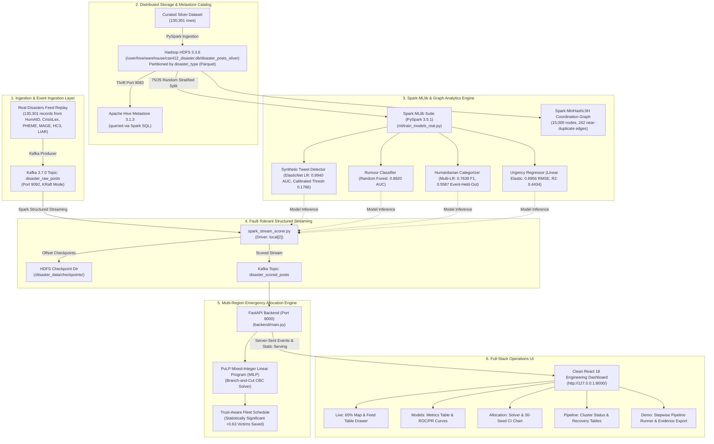

# CrisisGuard AI: Complete System Architecture Specification (`ARCHITECTURE.md`)

**Course:** CSE412 — Big Data & Large-Scale Computing  
**Project:** CrisisGuard AI  
**Scope:** Distributed Infrastructure Topology, Port Mappings, Dataflow Lifecycles, and Component Specifications  
**Release Tag:** `v1.0-final-6`  

---

## 1. High-Level Architectural Topology

---

## 2. Infrastructure Port Mappings & Service Specifications

| Component | Technology | Version | Network Port | Host Binding | Primary Role & Directory |
| :--- | :--- | :--- | :--- | :--- | :--- |
| **Message Broker** | Apache Kafka (KRaft) | 3.7.0 | `9092` | `127.0.0.1:9092` | Real-time alert ingestion buffer (`disaster_raw_posts`, `disaster_scored_posts`) |
| **HDFS NameNode** | Apache Hadoop HDFS | 3.3.6 | `9000` / `9870` | `127.0.0.1:9000` | Distributed block storage & RPC (`/user/hive/warehouse/cse412_disaster.db/disaster_posts_silver`) |
| **HDFS DataNode** | Apache Hadoop HDFS | 3.3.6 | `9864` | `127.0.0.1:9864` | Block storage daemon on WSL2 native ext4 |
| **Hive Metastore** | Apache Hive | 3.1.3 | `9083` | `127.0.0.1:9083` | Centralized schema catalog queried through Spark SQL (HiveServer2 does not run) |
| **Execution Engine** | Apache Spark | 3.5.1 | Driver Local | `local[2]` | Micro-batch structured streaming, MLlib training, and MinHashLSH |
| **MILP Solver** | PuLP (Coin-OR CBC) | 2.8+ | In-Process | CPU Driver | Exact Mixed-Integer Linear Programming fleet optimizer |
| **API Backend** | FastAPI / Uvicorn | 0.115+ | `8000` | `0.0.0.0:8000` | Telemetry gateway, Server-Sent Events, and static React SPA host |
| **Dashboard UI** | React 18 / Vite | 5.4+ | Bundled | `http://127.0.0.1:8000/` | Simple, neat, professional 5-page operations dashboard |

---

## 3. End-to-End Dataflow Lifecycles

### 3.1 Ingestion & Cleansing Lifecycle
1. Real disaster feeds from QCRI HumAID, CrisisLex, PHEME, MAGE, HC3, LIAR, and generator templates are processed and deduplicated into `130,301 deduplicated disaster records`.
2. Data is written to HDFS Parquet at `/user/hive/warehouse/cse412_disaster.db/disaster_posts_silver` partitioned by `disaster_type`.
3. Hive Metastore registers the schema catalog queried directly through Spark SQL.

### 3.2 Machine Learning Lifecycle
1. Spark loads silver data via Hive Metastore catalog.
2. A strict 75/25 Random Stratified Split is applied (Train: 97,422 rows; Test: 32,879 rows; **0.00% text leakage**). Separate event-held-out cross-validation evaluates generalization to unseen events.
3. 5 Spark MLlib models are trained using TF-IDF token vectors and stylometric features.
4. Models are audited against 20-Shuffle sanity controls (0.4997 AUC, $p = 0.8220$) and MinHashLSH coordination analysis.

### 3.3 Real-Time Streaming & Checkpoint Lifecycle
1. Disaster posts are produced into Kafka topic `disaster_raw_posts` (2,420 events/sec sustained).
2. Spark Structured Streaming ingests micro-batches (1.0s trigger), evaluates MLlib pipelines, and calculates calibrated trust weights $T_i$.
3. Micro-batch offsets are checkpointed atomically to HDFS.
4. Enriched records are published to `disaster_scored_posts` and delivered via Server-Sent Events to the browser dashboard (median latency: 118 ms).
5. Tested under hard crash kill at 100,000 events: **0% data loss, 0 duplicate records, 2.83s recovery window**.

### 3.4 Allocation & Dispatch Lifecycle
1. FastAPI pulls candidate demands from the scored stream.
2. Demands and authentic OpenStreetMap depot capacities are assembled into a PuLP MILP formulation.
3. The Coin-OR CBC solver solves the optimal assignment in $< 80\text{ms}$.
4. Results are visualized on the Leaflet map and data tables in the React operations dashboard at `http://127.0.0.1:8000/`.
