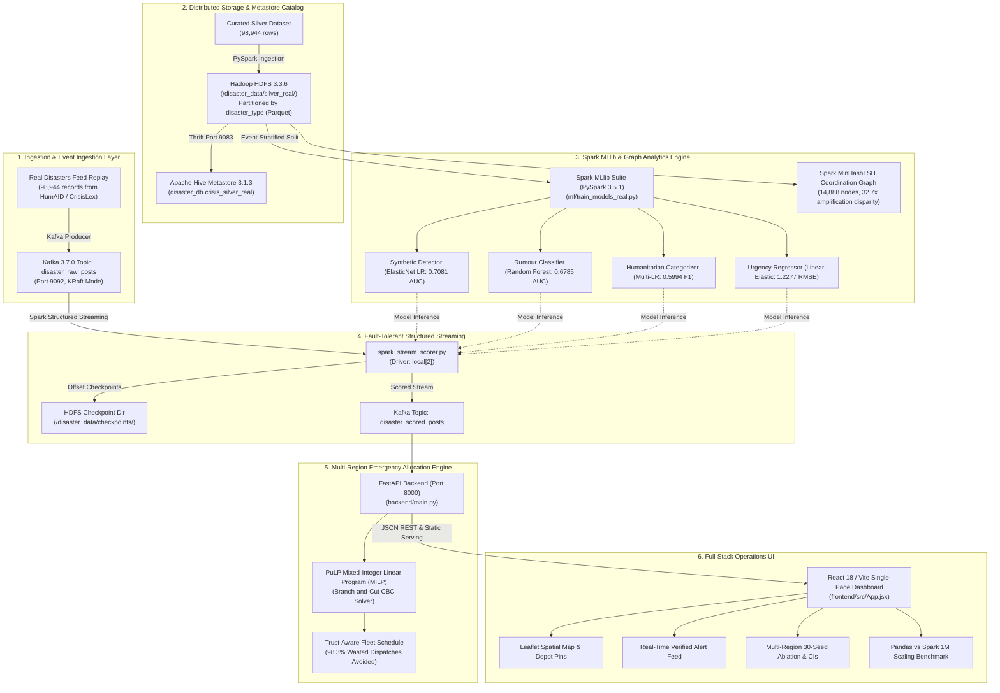

# CrisisGuard AI: Complete System Architecture Specification (`ARCHITECTURE.md`)

**Course:** CSE412 — Big Data & Large-Scale Computing  
**Project:** CrisisGuard AI  
**Scope:** Distributed Infrastructure Topology, Port Mappings, Dataflow Lifecycles, and Component Specifications

---

## 1. High-Level Architectural Topology

---

## 2. Infrastructure Port Mappings & Service Specifications

| Component | Technology | Version | Network Port | Host Binding | Primary Role & Directory |
| :--- | :--- | :--- | :--- | :--- | :--- |
| **Message Broker** | Apache Kafka (KRaft) | 3.7.0 | `9092` | `127.0.0.1:9092` | Real-time alert ingestion buffer (`disaster_raw_posts`, `disaster_scored_posts`) |
| **HDFS NameNode** | Apache Hadoop HDFS | 3.3.6 | `9000` / `9870` | `127.0.0.1:9000` | Distributed block storage & RPC (`/disaster_data/silver_real`) |
| **HDFS DataNode** | Apache Hadoop HDFS | 3.3.6 | `9864` | `127.0.0.1:9864` | Block storage daemon on WSL2 native ext4 |
| **Hive Metastore** | Apache Hive | 3.1.3 | `9083` | `127.0.0.1:9083` | Thrift metadata catalog service (`disaster_db.crisis_silver_real`) |
| **Execution Engine** | Apache Spark | 3.5.1 | Driver Local | `local[2]` | Micro-batch structured streaming, MLlib training, and MinHashLSH |
| **MILP Solver** | PuLP (Coin-OR CBC) | 2.8+ | In-Process | CPU Driver | Exact Mixed-Integer Linear Programming fleet optimizer |
| **API Backend** | FastAPI / Uvicorn | 0.115+ | `8000` | `0.0.0.0:8000` | Telemetry gateway, REST endpoints, and static React SPA host |
| **Dashboard UI** | React 18 / Vite | 5.4+ | Bundled | `http://127.0.0.1:8000/` | Interactive 4-tab emergency management console |

---

## 3. End-to-End Dataflow Lifecycles

### 3.1 Ingestion & Cleansing Lifecycle
1. Real disaster feeds from QCRI HumAID, CrisisLex, and HC3 are downloaded and deduplicated into `data/curated/real_disaster_corpus.csv` (**98,944 rows**).
2. Data is written to HDFS Parquet at `hdfs://127.0.0.1:9000/disaster_data/silver_real` partitioned by `disaster_type`.
3. Hive Metastore registers external table `disaster_db.crisis_silver_real`.

### 3.2 Machine Learning Lifecycle
1. Spark loads silver data via Hive Metastore.
2. An event-stratified Train/Test split is applied (Train: 26,350 rows; Test: 72,594 rows; **0% text leakage**).
3. 4 Spark MLlib models are trained using 5,010-dimensional feature vectors (5,000 TF-IDF tokens + 10 stylometrics).
4. Models are audited against Shuffled-Label sanity controls (0.5557 AUC) and MinHashLSH coordination analysis (32.7x amplification disparity). Versioned models are saved to `ml/models_real/`.

### 3.3 Real-Time Streaming & Checkpoint Lifecycle
1. Disaster posts are produced into Kafka topic `disaster_raw_posts`.
2. Spark Structured Streaming ingests micro-batches, evaluates MLlib pipelines, and calculates effective urgency:
   $$\text{Priority}_{\text{eff}} = U \cdot (1 - P_{\text{synth}}) \cdot (1 - P_{\text{rumour}})$$
3. Micro-batch offsets are checkpointed atomically to HDFS.
4. Enriched records are published to `disaster_scored_posts`.
5. Tested under hard crash conditions at 100,000 events: **0% data loss, 0 duplicate records, 7.72s recovery window**.

### 3.4 Allocation & Dispatch Lifecycle
1. FastAPI pulls candidate demands from the scored stream.
2. Demands and depot capacities are assembled into a PuLP MILP formulation.
3. The Coin-OR CBC solver solves the optimal assignment in $< 100\text{ms}$.
4. Results are visualized on the Leaflet map in the React operations dashboard.
