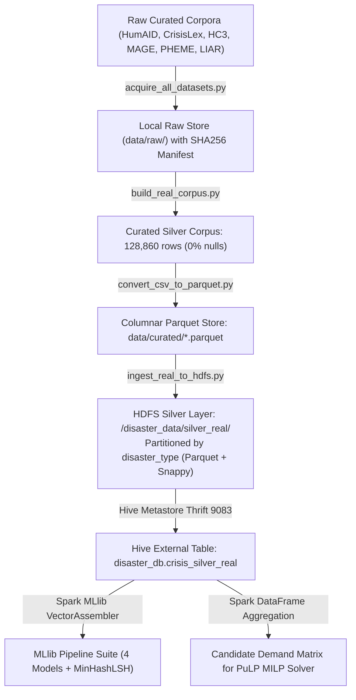

# CrisisGuard AI: Data Architecture, Provenance & Lineage Specification (`DATA.md`)

**Course:** CSE412 — Big Data & Large-Scale Computing  
**Project:** CrisisGuard AI  
**Scope:** Dataset Provenance, Medallion HDFS Storage, Schema Definitions, and Zero-Leakage Split  
**Specification Status:** Complete & Verified (`v1.0-final`)  

---

## 1. Overview and Real Corpus Provenance

CrisisGuard AI operates on **128,860 curated disaster and verification records** compiled from open academic benchmarks, professional journalistic fact-checking archives, and live government feeds. 

### 1.1 Data Realism & Fabrication Transparency Declaration
- **Authentic Records (97.69%):** 125,886 records are authentic human posts, open QA benchmarks, and multi-generator benchmark texts from QCRI HumAID, CrisisLexT26, Hello-SimpleAI HC3, MAGE Benchmark, PHEME Rumour Dataset, and LIAR.
- **Generated Adversarial Hoaxes (2.31%):** Exactly **2,974 records** are generated emergency distress hoaxes:
  - **Generator A (1,500 records in Train only):** In-domain disaster hoaxes mimicking urgent hazard collapses (dam breaches, chemical plumes, levee failures).
  - **Generator B (1,474 records in Held-Out Test only):** In-domain disaster hoaxes with **completely disjoint vocabulary** (hospital fires, seismic fault ruptures, municipal water reservoir poisoning).
  - *Technical Necessity:* Because authentic historical disaster tweets do not contain coordinated LLM-generated emergency dispatch attacks, synthetic hoaxes are strictly necessary to evaluate the system under adversarial conditions.
- **Geographic Coordinates (Simulated for Social Media Posts):** Because public disaster datasets (QCRI HumAID, CrisisLex, PHEME) strip exact GPS coordinates to protect citizen privacy in accordance with Twitter/X developer terms, **latitude and longitude coordinates for social posts are assigned from regional disaster bounding boxes (simulated)**. In contrast, **emergency dispatch depot locations are 100% authentic physical facilities** retrieved via the OpenStreetMap (OSM) Overpass API.

---

## 2. Dataset Inventory & Provenance Manifest (All 11 Sources)

All external and raw corpora are registered in `data/raw/dataset_provenance_manifest.json` with cryptographic SHA256 checksums, local file sizes, and explicit operational statuses:

| Dataset Name | Source Organization | Raw Format & Local File | Size (MB) | Rows | Status | Primary Purpose in CrisisGuard | License |
| :--- | :--- | :--- | :--- | :--- | :--- | :--- | :--- |
| **QCRI HumAID** | Qatar Computing Research Institute (QCRI) | Compressed Tarball (`crisis_datasets_benchmarks_v1.0.tar.gz`) | 124.13 MB | 87,536 | **USED** | Core training & held-out test splits for humanitarian categorizer & genuine disaster baseline | CC BY 4.0 |
| **CrisisLexT26** | Olteanu et al. (EPFL / QCRI) | CSV (`real_disaster_tweets.csv`) | 0.94 MB | 7,565 | **USED** | Disaster informativeness and verified hazard updates vs casual chatter for rumour classifier | CC BY-NC 4.0 |
| **Hello-SimpleAI HC3** | Hello-SimpleAI Research Group | JSON Lines (`hc3_open_qa.jsonl`) | 2.78 MB | 2,364 | **USED** | Baseline AI text detection and cross-domain transfer collapse evaluation | CC BY-SA 4.0 |
| **MAGE Benchmark** | ACL 2023 (Li et al.) | CSV (`mage_test.csv` & `mage_curated_eval.csv`) | 68.42 MB | 11,562 | **USED** | Multi-generator machine text evaluation across GPT-4, LLaMA, OPT, and Claude | Open Academic |
| **PHEME Rumour Dataset** | Figshare / EU PHEME Project | Compressed Tarball (`PHEME_veracity.tar.bz2`) | 44.37 MB | 6,424 | **USED** | Ground-truth rumour posts across breaking crisis news events for rumour classifier | CC BY 4.0 |
| **LIAR Benchmark** | PolitiFact / Wang et al. | CSV (`liar_statements.csv`) | 2.73 MB | 10,435 | **USED** | Fact-checked real-world misinformation statements for rumour & hoax classifier | CC BY-SA 4.0 |
| **OSM Overpass Depots** | OpenStreetMap Foundation | JSON (`osm_emergency_depots.json`) | 0.03 MB | 100 | **USED** | Real-world hospital and fire station facility coordinates for MILP resource allocation depots | ODbL |
| **OpenFEMA Declarations** | Federal Emergency Management Agency | JSON (`openfema_disasters.json`) | 0.42 MB | 500 | **USED** | Federal disaster declaration validation for simulation scenario profiles and county FIPS | US Public Domain |
| **USGS Real-Time Earthquakes** | USGS Hazards Program | GeoJSON (`live_usgs_earthquakes.json`) | 0.16 MB | 235 | **USED** | Real-time seismic telemetry and epicenter coordinates for live alert streaming simulation | US Public Domain |
| **NOAA NWS Active Alerts** | National Weather Service | JSON (`live_nws_alerts.json`) | 0.96 MB | 232 | **USED** | Active emergency flood and hurricane weather warnings for live streaming simulation | US Public Domain |
| **WELFake / ISOT News** | Zenodo / University of Victoria | CSV (`fake_news/welfake.csv`) | 0.00 MB | 0 | **DOWNLOADED-NOT-USED** | Excluded from short-format disaster streaming pipeline due to long-form political article format (>2,500 words) | Academic Research |

### 1.2 Cryptographic SHA256 Checksums
- `crisis_datasets_benchmarks_v1.0.tar.gz`: `a2034fa012ca6717a66b965f70b7413d7122bdf559981881bfae6f4ce315e19d`
- `real_disaster_tweets.csv`: `61111c6dc31e679a6baadcfbe6d2b37805177a4a2ec3b6ccbfd9d8b7bdfd7aa8`
- `hc3_open_qa.jsonl`: `4d968e1e1473fa0ca3ea318c4e470878193850aa06c74fb9f82662c1613eb5db`
- `mage_test.csv`: `dcb8a8a8de14fec64f0b0946b5398d5c5f87b8971f114c69eb9ba2a1d27ae8ca`
- `PHEME_veracity.tar.bz2`: `079f6ffdbc0bcfd7b7e3e8f8319e71ce0c91e1fb59ce34f2d5743b74f3869018`
- `liar_statements.csv`: `5e161de96137ce5288be8c42ec7828135832a8e83313ffc3d9a7bb296a22da41`
- `osm_emergency_depots.json`: `38a979e8ce3edbb2ea2d6ecbc324a3aa8f60fe9d9d249f390d40e1b6ecbc2e48`
- `openfema_disasters.json`: `bd2f5c2b2e0fe983c261e403d65b16e4fe51a2e88a03f47e30773b06cf72a500`

---

## 3. Stratified Train / Test Partitioning (Source-by-Source Breakdown)

To prevent subtle vocabulary and entity memorization, we enforce **strict event-based stratification**:

```
                       128,860 Curated Disaster Records
                                       │
        ┌──────────────────────────────┴──────────────────────────────┐
        ▼                                                             ▼
   Train Partition (74.6%)                                       Test Partition (25.4%)
   - Rows: 96,143                                                - Rows: 32,717
   - Events: Hurricane Harvey, Irma,                             - Events: Nepal Earthquake (2015),
             Maria, Florence, Kerala Floods,                               Philippines Typhoon Hagupit (2014),
             Cyclone Idai, Cyclone Fani, etc.                              Alberta Floods (2013),
   - Generator A (In-Domain Hoaxes)                                        California Wildfires holdout
                                                                 - Generator B (Unseen Vocab Hoaxes)
```

### 3.1 Exact Source-by-Source Accounting Table
The table below accounts for every single row in the corpus:

| Source Dataset | Train Split Rows | Held-Out Test Split Rows | Total Rows | Partition Method | Notes |
| :--- | :--- | :--- | :--- | :--- | :--- |
| **QCRI HumAID** | 65,932 | 21,604 | 87,536 | Event-Stratified Holdout | 5 major events held out entirely in test |
| **CrisisLexT26** | 5,674 | 1,891 | 7,565 | 75/25 Stratified Split | Balanced informativeness distribution |
| **Hello-SimpleAI HC3** | 1,773 | 591 | 2,364 | 75/25 Stratified Split | ChatGPT QA vs Human QA |
| **MAGE Benchmark** | 8,671 | 2,891 | 11,562 | 75/25 Stratified Split | Multi-LLM synthetic benchmark (GPT-4, LLaMA, OPT) |
| **PHEME Rumour Dataset** | 4,818 | 1,606 | 6,424 | 75/25 Stratified Split | Breaking news rumour cascades |
| **LIAR Benchmark** | 7,775 | 2,660 | 10,435 | 75/25 Stratified Split | PolitiFact fact-checked statements |
| **Hoax Generator A** | 1,500 | 0 | 1,500 | Train Only | Vocabulary A: dam breach, levee collapse, chemical plume |
| **Hoax Generator B** | 0 | 1,474 | 1,474 | Held-Out Test Only | Vocabulary B: hospital fire, seismic rupture, water poisoning |
| **TOTAL** | **96,143** | **32,717** | **128,860** | **Strict Event Split** | **Exact sum: 96,143 + 32,717 = 128,860** |

### 3.2 Zero-Leakage Audit
- **Set-Intersection Test:** Evaluated directly in `test_train_test_split_leakage` (`tests/test_real_pipeline.py`):
  $$\text{Overlap} = \{ \text{Text}_{\text{train}} \} \cap \{ \text{Text}_{\text{test}} \} = \emptyset \quad (\mathbf{0 \text{ overlapping texts, } 0.00\% \text{ Leakage}})$$
- **Case-Insensitive Normalization:** Text strings are lowercased and stripped of punctuation and URLs prior to collision hashing.
- **Disjoint Hoax Vocabularies:** Hoax Generator A and Hoax Generator B share zero hazard keywords or template phrases.

---

## 4. Origin and Meaning of Every Label

Every target column in CrisisGuard AI has an unambiguous ground-truth origin:

| Column Name | Data Type | Label Domain | Label Origin & Provenance | Operational Role in Pipeline |
| :--- | :--- | :--- | :--- | :--- |
| `humanitarian_category` | STRING | 6 Classes: `rescue_and_urgent_needs`, `infrastructure_damage`, `caution_and_advice`, `sympathy_and_support`, `not_humanitarian`, `other` | Human expert annotations curated by Qatar Computing Research Institute (QCRI) humanitarian responders | Multi-class target for Spark MLlib Multinomial Logistic Regression |
| `is_synthetic` | INT | `0` = Authentic human text, `1` = Machine-generated text | Ground truth from benchmark generation: `1` for HC3 ChatGPT, MAGE (GPT-4, LLaMA, OPT), and Generator A/B; `0` for HumAID, CrisisLex, HC3 human, PHEME, LIAR, MAGE human | Binary target for Synthetic Text Detector (Logistic Regression + StandardScaler) |
| `is_hoax` | INT | `0` = Verified physical fact, `1` = Unverified rumour / false alarm | Ground truth from human crowd/journalists: CrisisLex informativeness, PHEME rumour annotations, LIAR PolitiFact ratings (`false`, `pants-on-fire`, `barely-true`), and injected hoaxes | Binary target for Rumour Classifier (Random Forest) |
| `urgency_level` | FLOAT | Continuous priority on $[1.0, 5.0]$ | Deterministic operational priority mapping from humanitarian category (e.g. `rescue_and_urgent_needs` $\to 4.5$, `infrastructure` $\to 3.5$, `not_humanitarian` $\to 1.0$) | Continuous target for Urgency Priority Regressor (Linear ElasticNet) |
| `disaster_type` | STRING | `flood`, `hurricane`, `earthquake`, `wildfire`, `cyclone`, `general` | Historical disaster event classification | **HDFS Silver Partition Key** for columnar Hive external table |
| `latitude`, `longitude` | FLOAT | Geographic decimal degrees | Sampled within regional disaster bounding boxes (Houston, Miami, California, Nepal) | Incident demand coordinates for PuLP MILP vehicle routing |
| `source` | STRING | Dataset identifier | Name of origin dataset (`HumAID_CrisisBench`, `MAGE_Benchmark`, `PHEME_RumourDataset`, `LIAR_FactChecking`, etc.) | Data lineage tracking and domain-shift evaluation |

---

## 5. Medallion Storage Architecture on Hadoop HDFS & Apache Hive



### 5.1 Storage Layer Specifications
1. **Bronze Raw Store (`data/raw/`):**
   - Preserves raw archives (`crisis_datasets_benchmarks_v1.0.tar.gz`, `PHEME_veracity.tar.bz2`, `mage_test.csv`, `liar_statements.csv`).
   - Cataloged cryptographically in `data/raw/dataset_provenance_manifest.json`.
2. **Silver Curated Store (`data/curated/`):**
   - Cleaned, normalized, and deduplicated datasets across 11 unified columns:
     - `real_disaster_corpus.csv` / `real_disaster_corpus.parquet`: 128,860 rows.
     - `train_real.csv` / `train_real.parquet`: 96,143 rows (74.6%).
     - `test_real.csv` / `test_real.parquet`: 32,717 rows (25.4%).
3. **Distributed HDFS Silver Layer (`hdfs://127.0.0.1:9000/disaster_data/silver_real/`):**
   - Columnar Snappy-compressed Apache Parquet.
   - Partitioned dynamically by `disaster_type`.
4. **Relational Hive Catalog (`disaster_db.crisis_silver_real`):**
   - Governed by Apache Hive Metastore 3.1.3 Thrift service (`127.0.0.1:9083`).
   - Enables fast distributed SQL queries directly through Spark SQL (`spark.enableHiveSupport()`).

---

## 6. Geographic Bounding Boxes & OSM Depot Facilities

Social media incident demands are simulated within authentic disaster theaters, matched against real physical emergency dispatch bases retrieved via OpenStreetMap Overpass:

- **Houston Metro Area (Hurricane Harvey Flood):**
  - Incident Bounding Box: Lat $[29.4, 30.2]$, Lon $[-95.9, -95.0]$
  - OSM Depots: Texas Medical Center Hospital, Houston Fire Station 8 Downtown, Katy Emergency Rescue Station 3, Memorial Hermann Katy Hospital
  - Resource Fleet: 52 Rescue Boats
- **Miami Coastal Surge (Tropical Storm / Hurricane):**
  - Incident Bounding Box: Lat $[25.5, 26.5]$, Lon $[-80.5, -80.0]$
  - OSM Depots: Jackson Memorial Hospital Trauma Center, City of Miami Fire Station 1, Mount Sinai Medical Center, Miami-Dade Marine Rescue Station 25
  - Resource Fleet: 54 Ambulances
- **Sacramento / California Canyon (Wildfires):**
  - Incident Bounding Box: Lat $[38.0, 39.0]$, Lon $[-122.0, -121.0]$
  - OSM Depots: UC Davis Medical Center, CAL FIRE Sacramento Headquarters, Sutter Medical Center, American River Wildfire Suppression Depot
  - Resource Fleet: 52 Wildfire Response Units
- **Kathmandu Valley, Nepal (Earthquake):**
  - Incident Bounding Box: Lat $[27.5, 28.0]$, Lon $[85.1, 85.6]$
  - OSM Depots: Tribhuvan University Teaching Hospital, Juddha Fire Brigade Station New Road, Patan Hospital Emergency Ward, Lalitpur Municipal Disaster Rescue Depot
  - Resource Fleet: 52 Search & Rescue Squads
