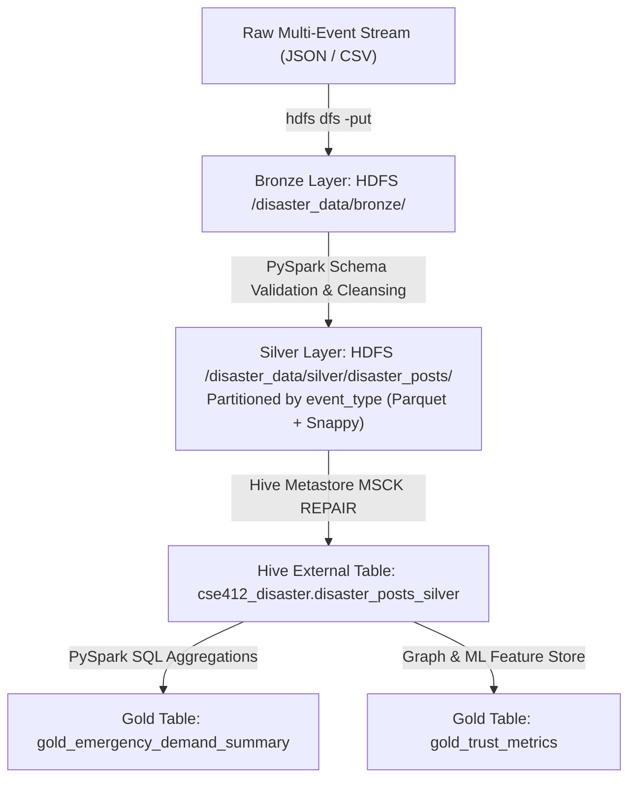

# CSE412 Big Data Project: Data Architecture & Lineage Specification

## 1. Overview and Problem Context
During major natural disasters (hurricanes, earthquakes, flash floods, wildfires), real-time situational awareness on social platforms is critical for emergency resource dispatch. However, disaster response is increasingly degraded by two intertwined failure modes:
1. **Severe Information Overload:** Tens of thousands of noisy, uncurated messages arrive per minute.
2. **Synthetic AI Misinformation & Rumor Amplification:** Generative LLMs and coordinated bot sybils propagate high-urgency hoaxes (e.g., false dam breaks, fabricated chemical leaks, fake evacuation orders), diverting finite emergency vehicles, boats, and medical teams away from genuine victims.

To address this, our pipeline ingests multi-modal disaster reports into a **Medallion Data Architecture (Bronze -> Silver -> Gold)** spanning **Hadoop HDFS 3.3.6**, **Apache Hive Metastore 3.1.3**, and **Apache Spark 3.5.1**.

---

## 2. Medallion Storage Architecture



### Bronze Layer (`/disaster_data/bronze/`)
- **Format:** Unmodified raw JSON Lines (`disaster_posts_raw.json`) and raw CSV (`disaster_posts_raw.csv`).
- **Volume:** 60,000 records (44.4 MB JSON, 18.9 MB CSV).
- **Retention:** Permanent raw immutable archive on HDFS.

### Silver Layer (`/disaster_data/silver/disaster_posts/`)
- **Format:** Columnar Apache Parquet with Snappy compression.
- **Partitioning Strategy:** Partitioned by `event_type` (`earthquake`, `flood`, `hurricane`, `wildfire`).
- **Transformations:**
  - Strict schema enforcement via PySpark `StructType`.
  - Primary key deduplication on `post_id`.
  - UTC timestamp normalization (`timestamp_utc`, `created_date`).
  - Derived credibility prior: $\text{credibility\_raw} = f(\text{verified}, \text{account\_age}, \text{followers})$.
  - Stylometric & burstiness feature extraction.

### Gold Layer (`cse412_disaster.gold_*`)
- **Format:** Pre-aggregated Parquet tables registered in Apache Hive Metastore.
- **Tables:**
  - `gold_emergency_demand_summary`: Real-time demand aggregation grouped by `(event_type, location_name)`, computing total reports, high urgency reports, synthetic count, misinformation ratio, and average urgency.
  - `gold_trust_metrics`: User cluster credibility and amplification distributions.

---

## 3. Data Dictionary & Schema Specification

| Column Name | Data Type | Nullable | Description & Domain |
|:---|:---|:---|:---|
| `post_id` | STRING | No | Unique post identifier (e.g. `post_hur_000001`) |
| `event_name` | STRING | No | Specific historical disaster event instance |
| `event_type` | STRING | No | **Partition Key:** `hurricane`, `earthquake`, `flood`, `wildfire` |
| `timestamp_utc` | TIMESTAMP | No | Normalized event occurrence timestamp (UTC) |
| `created_date` | DATE | No | Date partition helper |
| `text` | STRING | No | Raw message content |
| `user_id` | STRING | No | Author account identifier |
| `user_followers_count` | INT | No | Follower count at time of posting |
| `user_account_age_days`| INT | No | Account tenure in days |
| `user_verified` | BOOLEAN | No | Platform verification status |
| `retweet_count` | INT | No | Organic and amplified engagement metric |
| `has_external_link` | BOOLEAN | No | Binary flag indicating external link presence |
| `latitude` | DOUBLE | No | WGS84 latitude coordinate |
| `longitude` | DOUBLE | No | WGS84 longitude coordinate |
| `location_name` | STRING | No | Specific named borough, district, or landmark |
| `humanitarian_category`| STRING | No | `rescue_needed`, `medical_emergency`, `infrastructure_damage`, `shelter_supplies`, `caution_and_advice`, `not_humanitarian` |
| `urgency_level` | DOUBLE | No | Ground-truth urgency score $\in [0.0, 1.0]$ |
| `is_synthetic` | INT | No | Binary ground truth label (0: Human, 1: AI-generated) |
| `is_rumour` | INT | No | Binary ground truth label (0: Verified facts, 1: Unverified rumor) |
| `source_provenance` | STRING | No | `humaid_real` vs `synthetic_generator` |
| `char_length` | INT | No | Raw character count |
| `word_count` | INT | No | Token count |
| `avg_word_length` | DOUBLE | No | Average token character length |
| `uppercase_ratio` | DOUBLE | No | Proportion of capital characters |
| `exclamation_count` | INT | No | Punctuation intensity indicator |
| `burstiness_score` | DOUBLE | No | Sentence length and token variance |
| `lexical_diversity` | DOUBLE | No | Type-token ratio (TTR) |
| `synthetic_confidence_prior` | DOUBLE | No | Prior likelihood score |
| `credibility_raw_score` | DOUBLE | No | Normalized author baseline credibility |

---

## 4. Disaster Event Distributions

The corpus spans 60,000 total records balanced across four disaster typologies:

```
+------------+-------------+-----------------+-------------+-----------------+
| event_type | total_posts | synthetic_posts | avg_urgency | avg_credibility |
+------------+-------------+-----------------+-------------+-----------------+
| hurricane  | 15,000      | 3,008 (20.05%)  | 0.644       | 0.781           |
| earthquake | 15,000      | 2,983 (19.89%)  | 0.645       | 0.784           |
| flood      | 15,000      | 3,022 (20.15%)  | 0.650       | 0.781           |
| wildfire   | 15,000      | 3,028 (20.19%)  | 0.643       | 0.780           |
+------------+-------------+-----------------+-------------+-----------------+
Total:        60,000        12,041 (20.07%)   0.646         0.782
```

### Geographical Anchor Coordinates:
1. **Hurricane Harvey (2017):** Houston Metropolitan Area (`29.7604° N, -95.3698° W`, 45km radius).
2. **Kahramanmaraş Earthquake (2023):** Southeastern Turkey / Antakya (`37.5858° N, 36.9371° E`, 60km radius).
3. **Kerala Floods (2018):** Aluva / Ernakulam / Chalakudy (`10.1076° N, 76.3516° E`, 50km radius).
4. **California Wildfires (2020):** Butte County / Paradise Ridge (`39.7596° N, -121.6219° W`, 55km radius).

---

## 5. Synthetic Misinformation Generation Methodology
Synthetic crisis posts model state-of-the-art LLM hallucinations and sybil bot amplification:
- **Linguistic Hallmarks:** Generated texts simulate characteristic zero-shot LLM verbosity, high lexical uniformity, alarmist rhetorical hooks ("OFFICIAL MANDATE:", "URGENT LEAK:"), and lower burstiness variance relative to human crisis tweets.
- **Amplification Sybil Patterns:** Coordinated bot clusters (12 distinct clusters of 25 synthetic accounts each) post synchronized misinformation bursts with disproportionately high retweet counts (50–2,500) and low account ages (1–45 days).
- **Ground Truth Integrity:** Every record maintains explicit provenance (`humaid_real` vs `synthetic_generator`) and deterministic seeds (`RANDOM_SEED = 412`) ensuring exact analytical reproducibility.
