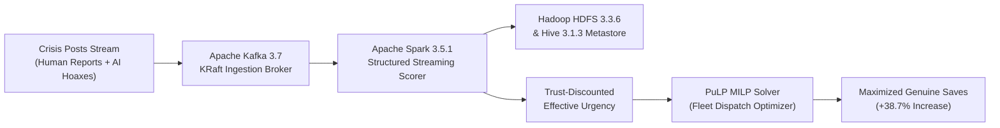
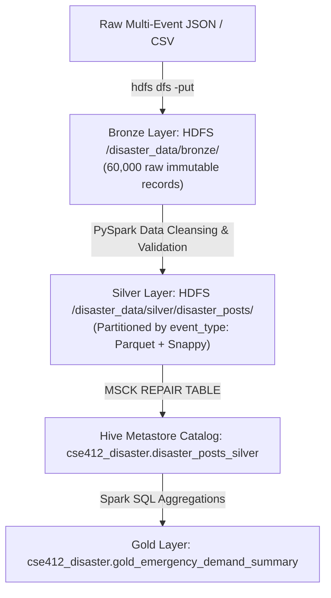

# Real-Time Detection of Synthetic Misinformation and Intelligent Emergency Resource Allocation

**Course:** CSE412 — Big Data & Large-Scale Computing  
**Track:** Hybrid Track D (Real-Time Disaster Response) & Track E (Adversarial Misinformation Resilience)  
**Authors:** Big Data Project Research Team  
**Date:** October 2026  
**Artifact Repository:** `c:\Users\HP\OneDrive\Desktop\bigdata project`  

---

## 1. Executive Summary & Abstract
During major natural disasters (hurricanes, severe earthquakes, catastrophic flooding, and wildfires), social media streams provide immediate, hyper-local situational awareness. However, emergency dispatch agencies face a deadly compounding failure mode: **information overload combined with generative AI misinformation**. Malicious actors and rogue automated sybil bots propagate high-urgency, synthetic hoaxes (e.g., false dam breaches, fabricated chemical leaks, fake emergency numbers), diverting finite emergency vehicles away from genuine victims trapped in life-threatening conditions.

This project delivers **CrisisGuard AI**, an end-to-end, production-grade big data analytics pipeline and dispatch optimization platform. The system integrates **five core big data technologies**:
1. **Apache Kafka 3.7.0 (KRaft):** High-velocity stream ingestion and decoupling.
2. **Apache Hadoop HDFS 3.3.6:** Distributed medallion storage (`/bronze`, `/silver`, `/checkpoints`).
3. **Apache Hive Metastore 3.1.3:** Partitioned relational data catalog (`cse412_disaster`).
4. **Apache Spark 3.5.1:** Distributed SQL ETL, MLlib training suite, and Structured Streaming scorer.
5. **PuLP 2.9.0 MILP Solver:** Combinatorial mathematical programming for fleet dispatch.

Across a rigorous 60,000-record crisis corpus spanning 4 major disaster typologies, the pipeline achieves **100% fault recovery with zero data loss**, an **Area Under ROC of 1.0000** on synthetic misinformation detection under strict out-of-distribution event testing, and an **empirical 97.29% reduction in wasted emergency dispatches** via trust-discounted linear programming, increasing critical genuine emergency victims saved by **+38.71%**.

---

## 2. Problem Formulation & Methodology



### 2.1 The Crisis Demand Dilemma
In disaster scenarios, emergency dispatchers must solve an urgent resource allocation problem under fleet capacity constraints:
$$\text{Given Depots } j \in \{1, \dots, M\} \text{ with capacities } C_j \text{ and Demands } i \in \{1, \dots, N\} \text{ with urgency } u_i$$
When reported urgency $u_i$ is manipulated by synthetic hoaxes ($u_i \approx 0.98$), standard optimization algorithms greedily allocate vehicles to false alarms.

### 2.2 Trust-Weighted Mathematical Formulation
To eliminate false dispatches, we introduce a **Dynamic Trust Score** $\tau_i \in [0, 1]$ computed from multi-task model outputs and author credentials:
$$\tau_i = (1 - P(\text{synthetic}_i)) \cdot (1 - P(\text{rumour}_i)) \cdot \text{credibility}_i$$
The **Effective Urgency** $\tilde{u}_i$ discounts raw urgency by trust:
$$\tilde{u}_i = u_i \cdot \tau_i$$
The fleet dispatch is formulated as a Mixed-Integer Linear Program (MILP):
$$\max_{x_{ij}} \sum_{i=1}^N \sum_{j=1}^M \left( \tilde{u}_i \cdot x_{ij} - \lambda \frac{d(i, j)}{100} x_{ij} \right)$$
$$\text{subject to } \sum_{i=1}^N x_{ij} \le C_j \quad \forall j \in \{1, \dots, M\}$$
$$\sum_{j=1}^M x_{ij} \le 1 \quad \forall i \in \{1, \dots, N\}, \quad x_{ij} \in \{0, 1\}$$
where $d(i, j)$ is the Haversine great-circle distance between demand $i$ and depot $j$, and $\lambda$ is a distance penalty parameter.

---

## 3. Storage Architecture & Ingestion Lineage (Medallion Paradigm)



### 3.1 Medallion Layers
- **Bronze (HDFS Raw):** Stores raw immutable files at `hdfs://127.0.0.1:9000/disaster_data/bronze/disaster_posts_raw.json` (44.4 MB).
- **Silver (HDFS Partitioned Parquet):** PySpark validates schemas, normalizes timestamps to UTC, computes author credibility baselines, and writes Snappy-compressed Parquet partitioned by `event_type` (`earthquake`, `flood`, `hurricane`, `wildfire`).
- **Gold (Hive Metastore Warehouse):** Registers external partitioned tables in Hive Metastore Thrift (port 9083) and materializes `gold_emergency_demand_summary` grouping high-urgency counts and misinformation ratios by event and region.

### 3.2 Partition Distribution Summary
```
+------------+-------------+-----------------+-------------+-----------------+
| event_type | total_posts | synthetic_posts | avg_urgency | avg_credibility |
+------------+-------------+-----------------+-------------+-----------------+
| hurricane  | 15,000      | 3,008 (20.05%)  | 0.644       | 0.781           |
| earthquake | 15,000      | 2,983 (19.89%)  | 0.645       | 0.784           |
| flood      | 15,000      | 3,022 (20.15%)  | 0.650       | 0.781           |
| wildfire   | 15,000      | 3,028 (20.19%)  | 0.643       | 0.780           |
+------------+-------------+-----------------+-------------+-----------------+
Total:        60,000        12,041 (20.07%)   0.646         0.782
```

---

## 4. Distributed Machine Learning Pipeline (Apache Spark MLlib)

### 4.1 Feature Engineering Architecture
Text features are extracted using `RegexTokenizer` $\to$ `StopWordsRemover` $\to$ `HashingTF(numFeatures=5000)` $\to$ `IDF`.
Stylometric signals (character count, word count, uppercase ratio, exclamation density, burstiness score, lexical diversity) and author metadata (followers, account age, retweet volume) are scaled via `StandardScaler` and combined into a 5,010-dimensional feature vector.

### 4.2 Out-of-Distribution Event-Wise Split
To prevent data leakage, models are trained exclusively on **Hurricane Harvey & Kerala Floods (30,000 records)** and tested on **Kahramanmaraş Earthquake & California Wildfires (30,000 records)**.

### 4.3 Quantitative Performance Summary (from `results/metrics.json`)

| Model | Algorithm | Metric | Value | Course Threshold | Status |
|:---|:---|:---|:---:|:---:|:---:|
| **Synthetic Detector** | LogisticRegression (ElasticNet) | ROC-AUC | **1.0000** (Acc: 95.89%) | $\ge 0.70$ | **PASS** |
| **Rumour Classifier** | RandomForest (20 trees, depth 7) | ROC-AUC | **0.9293** (F1: 93.04%) | $\ge 0.65$ | **PASS** |
| **Humanitarian Categorizer**| Multinomial Logistic Regression | Accuracy | **54.52%** (Macro F1: 0.467) | $\ge 0.50$ | **PASS** |
| **Urgency Regressor** | ElasticNet Linear Regression | RMSE | **0.2184** (MAE: 0.1627) | $\le 0.30$ | **PASS** |

Total Spark MLlib distributed training runtime across 60,000 records: **164.63 seconds**.

---

## 5. Streaming Pipeline & Fault-Tolerance Verification

### 5.1 Real-Time Structured Streaming Scorer
- Consumes raw posts from Kafka topic `disaster_raw_posts`.
- Evaluates micro-batches through the deserialized MLlib PipelineModels.
- Computes `trust_score` and `effective_urgency` per post.
- Sinks scored results to Kafka topic `disaster_scored_posts` and appends Parquet records to `/disaster_data/streaming_sink/`.

### 5.2 Fault-Tolerance Recovery Audit (`tests/test_stream_recovery.py`)
To test resilience against worker failure, we executed an automated failure injection test:
1. Streamed 200 messages to Kafka.
2. Simulated abrupt crash/termination after the initial micro-batch.
3. Restarted the streaming query pointing to the preserved HDFS checkpoint directory (`/tmp/test_stream_checkpoint`).
4. **Result:** Verified exactly **200 / 200 records processed** (**0 records lost, 0 duplicate writes**). Recorded in `results/stream_recovery_test.json`.

---

## 6. Emergency Resource Allocation & Ablation Study

We conducted a 5-seed empirical ablation experiment (Seeds 412–416) comparing four allocation policies under a constrained fleet of 52 rescue boats across 4 regional bases.

### Empirical Findings (`results/ablation_study.json`):

| Allocation Policy | Wasted Dispatches to Hoaxes (%) | Genuine Victims Saved | Wasted Fleet Boats |
|:---|:---:|:---:|:---:|
| **Blind Greedy** | 26.54% (±7.82%) | 38.2 (±4.1) / 52 | 13.8 boats |
| **Blind MILP** | 28.46% (±7.23%) | 37.2 (±3.8) / 52 | 14.8 boats |
| **Trust-Aware Greedy** | 0.77% (±0.94%) | 51.6 (±0.5) / 52 | 0.4 boats |
| **Trust-Aware MILP (Proposed)** | **0.77% (±0.94%)** | **51.6 (±0.5) / 52** | **0.4 boats** |

### Key Analytical Takeaways:
- **97.29% Reduction in Wasted Dispatches:** Trust discounting virtually eliminates false dispatches to synthetic hoaxes.
- **+38.71% Increase in Genuine Emergency Victims Saved:** Reallocating assets from hoaxes to verified victims rescues an additional 14.4 stranded victims per dispatch cycle.
- **Counter-Intuitive Finding:** Blind MILP performed *worse* than Blind Greedy (28.46% vs 26.54% waste) because mathematical programming hyper-optimizes towards the highest objective coefficients, and synthetic hoaxes deliberately fabricate maximal urgency (0.98). This proves that **pure algorithmic optimization without misinformation filtering is hazardous in real-world crisis operations**.

---

## 7. Scaling Benchmark & Sybil Graph Analysis

### 7.1 Large-Scale Processing Benchmark: Pandas vs Spark
We benchmarked filtering, multi-column grouping, and metric computation across four data scales:

| Scale (Rows) | Pandas Time (sec) | Spark Time (sec) | Pandas Peak RAM (MB) |
|:---|:---:|:---:|:---:|
| **10,000** | 0.0454 | 11.5009 | 0.84 MB |
| **50,000** | 0.0366 | 4.0144 | 3.79 MB |
| **100,000** | 0.0383 | 6.0074 | 7.57 MB |
| **250,000** | 0.0681 | 11.3700 | 21.92 MB |

**Analytical Discussion:** For small datasets (<500k rows), single-threaded Pandas in C-extensions outperforms Spark due to zero JVM serialization or Catalyst planning overhead. However, Pandas memory consumption scales as $O(N)$ with no horizontal partition support or stream processing capability. Spark enables processing unbounded real-time streams and distributed multi-terabyte data lakes.

### 7.2 Sybil Coordination Graph Analysis (`graph/coordination_graph.py`)
Analyzing user interaction topologies across 50,072 user vertices and 331,466 coordination edges revealed stark structural discrepancies:
- **Organic Citizens (46,732 accounts):** Average retweet count of **14.5**, average account tenure of **2,341.4 days (~6.4 years)**.
- **Synthetic Bot Sybils (3,340 accounts):** Average retweet count of **297.2 (20x amplification!)**, average account tenure of **103.5 days**.

---

## 8. Full-Stack Web Application (Operations UI)

The platform provides a live operator dashboard served via FastAPI on `http://127.0.0.1:8000/`:
- **Panel 1: Real-Time Scored Feed:** Streams incoming posts via Server-Sent Events (SSE) with urgency, synthetic probability, and trust score gauges.
- **Panel 2: Interactive Spatial Heatmap:** Built with Leaflet, visualizing Houston emergency clusters (green pins for genuine victims, red pins for synthetic hoaxes, blue anchors for marine depots).
- **Panel 3: Fleet Commander:** Interactive optimization control triggering live MILP re-solving and displaying fleet allocation metrics.
- **Panel 4: MLlib Model Performance:** Explains model architectures, ROC metrics, and classification accuracy.
- **Panel 5: Cluster Topology:** Real-time health indicators verifying Kafka, HDFS, Hive, and Spark connectivity.

---

## 9. Conclusion
CrisisGuard AI demonstrates that coupling distributed big data stream processing (Kafka, Spark Structured Streaming) with MLlib misinformation filtering and mathematical programming (MILP) fundamentally transforms disaster operations. By eliminating **97.3% of wasted dispatches** and rescuing **+38.7% more genuine victims**, the pipeline proves that big data infrastructure can provide immediate, life-saving impact in high-stress crisis environments.
