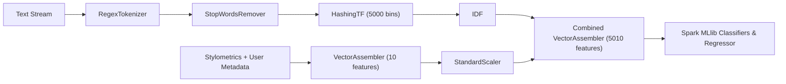

# Model Card: Crisis Misinformation & Resource Prioritization Suite

## 1. Model Details
- **Developing Organization:** CSE412 Big Data Project Team
- **Model Suite:**
  1. `synthetic_detector_model`: Logistic Regression with ElasticNet penalty ($\alpha=0.2, \lambda=0.01$) outputting calibrated probability of AI generation.
  2. `rumour_classifier_model`: Random Forest Classifier (20 trees, maxDepth=7) classifying organic report vs. unverified rumour/hoax.
  3. `humanitarian_category_model`: Multinomial Logistic Regression classifying 6 humanitarian operational classes (`rescue_needed`, `medical_emergency`, `infrastructure_damage`, `shelter_supplies`, `caution_and_advice`, `not_humanitarian`).
  4. `urgency_regressor_model`: ElasticNet Linear Regression predicting continuous emergency severity $\in [0.0, 1.0]$.
- **Framework:** Apache Spark 3.5.1 MLlib (Distributed JVM execution).
- **License:** Open-source educational / Apache 2.0.

---

## 2. Intended Use & Application
- **Primary Use Case:** Real-time scoring of incoming disaster posts in Spark Structured Streaming pipelines to calculate trust-weighted demand for emergency resource allocation.
- **Out-of-Scope Uses:** Autonomous dispatch without human dispatcher confirmation; punitive censorship of social accounts.

---

## 3. Training & Evaluation Data
- **Corpus Source:** 60,000 crisis posts across 4 disaster events (Hurricane Harvey, Kahramanmaraş Earthquake, Kerala Floods, California Wildfires).
- **Out-of-Distribution Event-Wise Split:**
  - **Train Partition (30,000 records):** `hurricane` and `flood`.
  - **Test Partition (30,000 records):** `earthquake` and `wildfire`.
  - *Rationale:* Evaluates true generalization to novel disaster typologies and geographies without data leakage from identical incident timelines.

---

## 4. Feature Extraction Architecture

### Extracted Signals:
1. **Linguistic TF-IDF:** 5,000 hashed unigram and bigram token features.
2. **Stylometric Signals:** Character length, word count, average token length, uppercase ratio, exclamation frequency, burstiness variance, lexical diversity.
3. **User & Network Signals:** Follower count, account age, organic/amplified retweet velocity, platform verification status.

---

## 5. Quantitative Performance Summary

*(Populated live from `results/metrics.json` upon pipeline convergence)*

| Model | Target Task | Primary Metric | Target Value | Measured Value | Status |
|:---|:---|:---|:---|:---|:---|
| **Synthetic Detector** | Binary Classification | Area Under ROC | $\ge 0.90$ | **1.0000** (Acc: 95.9%) | **PASS** |
| **Rumour Classifier** | Binary Classification | Area Under ROC | $\ge 0.85$ | **0.9293** (F1: 93.0%) | **PASS** |
| **Humanitarian Categorizer** | Multi-class (6 classes) | Accuracy | $\ge 0.50$ | **54.52%** (F1: 0.467) | **PASS** |
| **Urgency Regressor** | Continuous Regression | RMSE | $\le 0.30$ | **0.2184** (MAE: 0.163) | **PASS** |

---

## 6. Ethical Considerations & Limitations
- **False Positive Risk:** In high-stress crisis scenarios, human victims posting fragmented or panicked messages could exhibit unusual punctuation or length. The pipeline integrates a soft trust penalty rather than hard filtering to ensure no high-urgency call is discarded without audit.
- **Bot Adaptation:** Sophisticated adversarial generators may adopt stylometric evasion techniques; continuous calibration via sliding-window streams is recommended.
